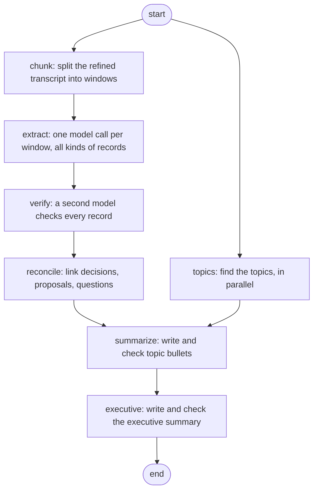

# Meeting AI

Upload an English meeting recording and get:

1. **Phase 1, transcript and facts:** a timestamped transcript plus everything extracted from it before any language model rewrites anything: numbers, dates and times, names, technical terms, negations, and candidate questions / proposals / commitments / decisions / tasks.
2. **Phase 2, refinement and speakers:** a **refined transcript** where mis-heard terms, acronyms and names are fixed, with a side-by-side view of **exactly what changed and why**, plus **who is speaking** and, when people say it themselves, **their names**.
3. **Phase 3, minutes:** decisions, action items (owner and deadline **only when stated**), open questions, proposals, disagreements, risks and key figures, topic minutes and an executive summary. Every item carries a quote from the transcript and was checked by a second model. The page shows **every model step** (what was asked, what came back, what our checks kept or dropped) and then the final report.

All heavy models run on APIs. Nothing needs a GPU. Nothing is tied to one meeting topic: terms and names are discovered from each recording.

---

## Quick start

```bash
git clone https://github.com/atrijopal/boot.git && cd boot
cp .env.example .env          # paste your API keys into .env (see "Get your API keys")
bash run.sh                   # installs everything on first run, then starts the app
# open http://localhost:8000
```

`bash run.sh` creates a private Python 3.12 environment and installs all dependencies the first time (a few minutes), then only starts the app on later runs.
Works on Linux, macOS, and Windows through WSL or Git Bash. Needs `bash`, internet access, and either `curl` or `pip`.

## All the ways to run it

| Command | What it does |
|---|---|
| `bash run.sh` | install if needed, start the web app on port 8000 |
| `bash run.sh --check` | check that your API keys work (prints OK / INVALID, never shows the keys) |
| `bash run.sh --all FILE` | run the **whole pipeline** (Phases 1, 2, 3) on one audio file from the terminal |
| `bash run.sh --cli FILE` | Phase 1 only, from the terminal |
| `bash run.sh --test` | run the 203 tests (no keys needed; the APIs are mocked) |
| `bash run.sh --setup` | install only |
| `PORT=8001 bash run.sh` | use another port |

Examples:
```bash
bash run.sh --all samples/new/ami_IS1003b_540s-840s.flac        # whole pipeline, results in outputs/<job_id>/
bash run.sh --all samples/jfk.flac --no-minutes                 # stop after Phase 2
```
After a terminal run, open the same job in the page: `http://localhost:8000/?job=<job_id>` (or use "Open an earlier result" at the top right).

**The web page** (one run, three steps on one page):
Choose an audio file (`.wav .mp3 .m4a .flac .ogg .opus .webm .aac`, up to 500 MB / 4 hours) and click **Process**. With **Run all three steps** ticked (the default), the server runs transcription, refinement and minutes one after another in that order, and each step's results appear as soon as it finishes:
1. **Transcript and facts:** transcript, numbers, names, terms, dates, negations, candidate lists.
2. **Refined transcript:** speaker panel (Accept / Reject / type a name), raw-versus-refined view, an edit table with the evidence for every edit, downloads.
3. **Minutes:** a live step list, then **A. every model step in order** and **B. the final report** with downloads (see "Phase 3" below).

The chain runs on the server, so it keeps going if you close or reload the tab; reopening the job (`/?job=<job_id>`) picks up the progress. If a step fails, the steps after it are marked *not started* with the reason, and nothing is generated from incomplete input.
After an Accept / Reject or a typed speaker name, click **Regenerate minutes** to rebuild the minutes from the corrected transcript (the page marks old minutes as out of date).
Untick **Run all three steps** to run only step 1 and start **Refine transcript** and **Generate minutes** yourself, for example to review the edits and speaker names before the minutes are written.

**The API** (what the page uses; you can call it yourself):
```bash
curl -F "file=@samples/jfk.flac" -F run_all=true localhost:8000/process-audio       # all three phases in one run -> {"job_id": "..."}
curl -F "file=@samples/jfk.flac" -F provider=groq localhost:8000/process-audio      # Phase 1 only
curl localhost:8000/jobs/<id>                                                        # status + results of all phases
curl -X POST localhost:8000/jobs/<id>/refine                                         # Phase 2
curl -X POST localhost:8000/jobs/<id>/minutes                                        # Phase 3
curl localhost:8000/jobs/<id>/minutes/stages                                         # every model call and our decisions
curl -O -J "localhost:8000/jobs/<id>/minutes/download?format=md"                     # md | json | csv | trace | stages
curl localhost:8000/jobs                                                             # earlier jobs on disk
```
Full contracts: `docs/phase1/CONTRACT.md`, `docs/phase2/CONTRACT.md`, `docs/phase3/CONTRACT.md`.

---

## Get your API keys

You need **one required key (Groq)** and **one optional key (Deepgram)**. Both have free tiers. Paste them into `.env`.

### Groq (required): transcription and the language models
1. Go to <https://console.groq.com> and sign up (Google login works).
2. Open **API Keys**, click **Create API Key**, copy it. It starts with `gsk_` and is shown only once.
3. In `.env`: `GROQ_API_KEY=gsk_...`

Groq does the speech-to-text (Whisper large-v3) and every language-model step.
**Free-tier limits** (from [Groq's rate-limit page](https://console.groq.com/docs/rate-limits), per model and per organisation): `gpt-oss-120b` and `gpt-oss-20b` get 30 requests per minute, 1,000 per day, **8,000 tokens per minute and 200,000 tokens per day**; Whisper gets 20 requests per minute and 2,000 per day.
A 10-minute meeting uses roughly 40,000 tokens through Phase 3, so the free tier covers only a handful of meetings a day (see Troubleshooting).

### Deepgram (optional, strongly recommended): speaker labels
1. Go to <https://console.deepgram.com> and sign up. Free credit is added automatically.
2. Open your project, then **Settings, API Keys, Create a New API Key**, copy it.
3. In `.env`: `DEEPGRAM_API_KEY=...`

Without it everything works except **who is speaking**: all lines show `SPEAKER_UNKNOWN`, and Phase 2 loses its "second opinion" signal.

Then run `bash run.sh --check`:
```
Groq      OK       key works, all needed models available (...)
Deepgram  OK       key works
```
Never commit `.env`: it is in `.gitignore`. Never paste keys into chat or tickets. If a key leaks, delete it in the console and create a new one.

---

## How it works

```
audio
 | Phase 1  (app/audio, app/asr, app/preprocessing)
 |-- validate -> decode to 16 kHz mono -> split at pauses (< 10 min chunks)
 |-- speech-to-text (API) -> RAW transcript (timestamped segments, word timings)
 |-- normalize (whitespace / duplicates only) -> NORMALIZED transcript
 '-- extract facts and context (every item points back to its segment)
 | Phase 2  (app/refinement)
 |-- second opinion from the other ASR + speaker labels
 |-- small LLM proposes exact edits -> code checks every edit -> larger LLM verifies
 '-- REFINED transcript + change log + speaker names
 | Phase 3  (app/minutes)        <- a LangGraph workflow, described below
 |-- extract records -> verify each against the transcript -> link them -> topics -> summaries
 '-- MINUTES (Markdown + JSON + CSV of action items) and the full step-by-step model log
```

### Phase 1: what runs where
| Step | Tool / model | Notes |
|---|---|---|
| Validation, decoding, chunking | PyAV, numpy, soundfile (local) | Empty, corrupt, silent, too-short or wrong-format files give a clear message. Your original file is never modified. |
| Speech-to-text | **Groq `whisper-large-v3`** (default) or **Deepgram `nova-3`** (adds speakers) | Switch in the dropdown or with `ASR_PROVIDER`. Results are cached, so re-running a file costs no new API call. |
| Normalization | pure Python | Whitespace, exact duplicates and Whisper's "no speech" hallucinations only. The raw transcript is kept. |
| Numbers, dates, times, durations | regex plus a spoken-number parser | Exact original text kept (`81.73%`, `2x`, `$200`, "twenty five percent"). Relative dates are never resolved. |
| Names | spaCy `en_core_web_md` | plus a low-confidence capitalisation check |
| Technical terms, acronyms | acronym patterns, `wordfreq` word rarity, TF-IDF noun phrases | Discovered per meeting, no domain word lists. Words in shaky ASR regions are flagged. |
| Negations | spaCy dependency parse | cue plus its scope |
| Questions, proposals, commitments, decisions, tasks, hedges | **LLM** (`LLM_MODEL`, default `openai/gpt-oss-120b`) | Only *candidates*. Every quote is checked to be verbatim; no owner or deadline is ever inferred. |

### Phase 2: how hallucination is kept down
| Step | Tool / model | Notes |
|---|---|---|
| Second opinion | the *other* ASR provider | Shows where two recognisers disagree ("Jessie" vs "Jesse"). |
| **Who speaks** | Deepgram diarization copied onto the text by timestamp | Acoustic, not an LLM guess. Mixed or uncovered lines are flagged, never split. |
| Proposing fixes | **`openai/gpt-oss-20b`** | Returns only `{find, replace, kind}` edits, never rewritten text. |
| Checking fixes | code, no LLM | Verbatim and unique; no overlap with numbers, dates, times, negations; no new digits; no deletions; size limits; then the Phase 1 extractors are **re-run** and must find the same facts. |
| Evidence rule | code | Auto-applied only if the new text appears elsewhere, the second ASR heard it, or it matches a Phase 1 term, **and** it sounds or looks like the original. Otherwise it is only *suggested*. |
| Verification | **`openai/gpt-oss-120b`** | Must confirm the same meaning and no new information. |
| **Who they are** | LLM proposal plus code check | Names only from what people say ("my name is..."), with a quote that must be verbatim and spoken by that voice. Weaker evidence ("Rose, can you...") is only suggested. No evidence means the speaker stays `SPEAKER_01`. |

Every edit ends as **applied**, **suggested** (you decide) or **blocked** (a rule failed, with the reason). The whole transcript is re-checked at the end: segment count, ids, timestamps, speakers, numbers, dates and negations must be unchanged, or the stage refuses to finish.

### Phase 3: the minutes, orchestrated with LangGraph
Phase 3 is a [LangGraph](https://langchain-ai.github.io/langgraph/) state graph (`app/minutes/graph.py`). Independent steps run in parallel, joins wait for everything they depend on, and each step has a typed state it reads and writes. The model calls themselves go through our own small client (`app/llm/client.py`), not through LangChain.



| Node | Model (default) | What it does | What our code checks (no model) |
|---|---|---|---|
| `chunk` | none | 60-segment windows, plus 6 segments of read-only context on each side | |
| `extract` | `gpt-oss-120b`, medium effort | Proposes records (decision, proposal, disagreement, action, question, risk, fact) with quotes | each quote must exist in the cited segment (a neighbouring one is accepted only if the quote is verbatim there); at least one quote from the window; no number that is not in the cited text; an owner only from a first-person commitment by a labelled speaker, or a name or role that appears in the quote; a deadline only if it appears in the quote |
| merge (inside `verify`) | none | joins duplicates from overlapping windows | text similarity plus shared evidence |
| `verify` | `gpt-oss-120b` | judges each record against the transcript around its quote; may correct a wrong status | each status has a plain-language meaning (`app/minutes/lenses.py`); unconfirmed records go to "needs review" and never reach the summaries |
| `reconcile` | `gpt-oss-120b` | links records (replaces, contradicts, adopts, rejects, answers) | the quote must be in the evidence of one of the two records |
| `topics` | `gpt-oss-20b` | proposes contiguous topics | ranges are made complete, non-overlapping and capped |
| `summarize` | `gpt-oss-20b` | writes 2 to 5 bullets per topic from its segments and verified records | no new numbers; cited ids must exist; then an independent checker confirms each bullet |
| `executive` | `gpt-oss-20b` | writes the executive summary | same checks; falls back to restating verified items if nothing passes |

**How LangGraph is used:** the state is a typed dictionary; parallel branches write to it through reducers (lists are concatenated, dictionaries merged). `topics` runs alongside the whole extraction branch, and `summarize` has two incoming edges, so it waits for both. In `MINUTES_EXTRACT_MODE=separate`, `extract` becomes four parallel nodes (decisions and proposals, actions, questions and risks, figures), which suits paid keys with higher limits.

**Tracing and visibility** (nothing leaves your machine):
- `trace.jsonl`: every node and model call with model, tokens, seconds, retries and cache hits.
- `stages.json`: every model call's input and raw output plus each keep or drop decision. This is what the page shows in part A.
- Optional **LangSmith** tracing (off by default, untested here): set `LANGSMITH_TRACING=true` and `LANGSMITH_API_KEY=...` in your shell (not in `.env`). It sends prompts and meeting transcripts to LangSmith's cloud, so only enable it for non-sensitive meetings.

**Reliability rules (kept deliberately simple):** every model call has a 90-second timeout and at most 3 tries; a rate-limit wait is capped at 45 seconds, and if the provider asks for a longer wait (a daily quota) the call fails at once with the provider's own message. A failed extraction window gets one more try at the end. One run stops after `MINUTES_MAX_SECONDS` (default 900) and reports what it could not finish. A run with failures is marked `partial`, never hidden.

Prompts are in `prompts/` and can be edited directly; a changed prompt automatically bypasses old cached answers.

### Outputs
Everything is written to `outputs/<job_id>/`:
- Phase 1: `raw_transcript.txt|json`, `normalized_transcript.json`, `protected_facts.json`, `meeting_context.json`, `phase1_result.json`, `asr_raw.json`
- Phase 2: `refined_transcript.txt|json`, `edits.csv|json`, `diff.txt`, `speakers.json`, `refinement.json`
- Phase 3: `minutes/runs/<run_id>/` with `minutes.md`, `minutes.json`, `action_items.csv`, `stages.json`, `trace.jsonl`
- `outputs/cache/` stores API results so repeat runs are free. `samples/example_outputs/` has one saved Phase 1 result.

---

## Configuration (`.env`)

| Variable | Default | Meaning |
|---|---|---|
| `GROQ_API_KEY` | | required |
| `DEEPGRAM_API_KEY` | | optional (speaker labels) |
| `ASR_PROVIDER` / `ASR_MODEL` | `groq` / provider default | speech-to-text provider (`groq` or `deepgram`) and model |
| `CANDIDATE_DETECTOR` / `LLM_MODEL` | `llm` / `openai/gpt-oss-120b` | Phase 1 candidate labelling (`off` to disable) |
| `REFINE_MODEL` / `REFINE_REASONING_EFFORT` | `openai/gpt-oss-20b` / `medium` | the small refiner (Phase 2) |
| `VERIFY_MODEL` / `VERIFY_ENABLED` | `openai/gpt-oss-120b` / `true` | the Phase 2 checker |
| `REFINE_USE_SECOND_ASR` | `true` | use the other ASR as evidence and for speaker labels |
| `MINUTES_EXTRACT_MODE` | `combined` | `combined` (one call per window) or `separate` (four) |
| `MINUTES_EXTRACT_MODEL` / `MINUTES_VERIFY_MODEL` | `openai/gpt-oss-120b` | Phase 3 extraction and checking (the 20b model returns nothing on the long combined prompt: measured) |
| `MINUTES_TOPICS_MODEL` / `MINUTES_WRITE_MODEL` | `openai/gpt-oss-20b` | Phase 3 topics and writing |
| `MINUTES_MAX_SECONDS` / `MINUTES_CONCURRENCY` | `900` / `2` | hard time limit for one run; simultaneous model calls |
| `LLM_BASE_URL` | Groq | any OpenAI-compatible endpoint (also change the key) |
| `CACHE_ENABLED`, `CHUNK_SECONDS` | `true`, `600` | caching; audio chunk size |

Models are swappable here without touching code.

---

## Project structure

```
.
├── run.sh                  one command: install, start, check, test, run the pipeline
├── README.md               this file
├── requirements.txt        all dependencies (including langgraph and the spaCy model)
├── .env.example            copy to .env and add your keys
├── app/
│   ├── api/                FastAPI server (upload, jobs, refine, minutes, downloads)
│   ├── asr/                Groq and Deepgram providers, retry handling
│   ├── audio/              validation, decoding, silence-aware chunking
│   ├── preprocessing/      Phase 1: normalization, extractors, LLM candidate labelling
│   ├── refinement/         Phase 2: edit proposals, gatekeeper, verifier, speakers, second ASR
│   ├── minutes/            Phase 3: LangGraph workflow, extraction, grounding checks, verifier, reconcile, topics, summaries, step log
│   ├── llm/                small OpenAI-compatible chat client (timeouts, retries, usage)
│   ├── schemas/            typed data models (Pydantic)
│   ├── config/             settings (.env)
│   └── utils/              errors, logging, cache
├── prompts/                every LLM prompt, versioned (prompts/minutes/ for Phase 3)
├── web/                    the interface: index.html and static/app.js, app.css
├── scripts/                run_all, run_phase1, check_keys, fetch_sample, benchmark_asr, eval_refinement
├── tests/                  203 tests (APIs mocked, no keys needed)
├── samples/                test audio (AMI meetings), bad inputs, an example output
├── docs/
│   ├── brief/              the original problem statement and project notes
│   └── phase1/ phase2/ phase3/   PLAN.md and CONTRACT.md for each phase
└── outputs/                generated at run time (git-ignored)
```

---

## Samples
`samples/` has short excerpts of AMI meetings (CC BY 4.0), five-minute ones in `samples/new/`, and broken inputs in `samples/bad/` that demonstrate the error messages. See `samples/README.md`. Quick first try: `bash run.sh --all samples/new/ami_IS1003b_540s-840s.flac`.

## Tests and measurements
- `bash run.sh --test`: 203 tests covering validation errors, extraction checks, the edit gatekeeper, speaker logic, the Phase 3 workflow with a scripted fake model, the API, timeouts and failure paths. They need no keys. The real Groq and Deepgram calls were checked separately, live.
- `python scripts/eval_refinement.py --refine-model openai/gpt-oss-20b --list` benchmarks the Phase 2 refiner on 12 hand-written passages with 13 injected mishearings (and 3 clean controls): **11 of 13 fixed, 0 false edits, 0 changes to numbers or negations**. The fixture is small and written by the authors, so it is indicative, not a general accuracy figure (`docs/phase2/PLAN.md`).
- Phase 3 was run live on several AMI excerpts; what it measured and the bugs it found are in `docs/phase3/PLAN.md`. A 10-minute excerpt took about 3 to 6 minutes and about 40,000 tokens on Groq's free tier.

---

## Troubleshooting

| Problem | Fix |
|---|---|
| "GROQ_API_KEY is not set" | Paste the key into `.env` (not `.env.example`) and **save the file**, then `bash run.sh --check`. |
| Minutes show "verifier unreachable", or a step says the provider's limit is reached and asks you to wait | Groq's free tier allows 200,000 tokens per day per model. The message includes how long to wait. Wait, then use "Regenerate minutes". Cached results are reused, so a re-run costs little. |
| A run seems stuck | It stops by itself after 15 minutes (`MINUTES_MAX_SECONDS`) and reports what it could not finish. The page shows elapsed time. |
| Port already in use | `PORT=8001 bash run.sh` |
| Install failed or a broken environment | `rm -rf .venv .venv_dir` then `bash run.sh` again (needs internet). |
| `Permission denied: run.sh` | Always start it with `bash run.sh`. |
| All speakers show `SPEAKER_UNKNOWN` | Add a Deepgram key, or select the `deepgram` provider. |
| A refinement you don't want | Click Reject on that edit. Rejected edits are saved in the outputs. |
| The page is blank after a restart | Use "Open an earlier result" (top right) or `/?job=<job_id>`: everything is reloaded from `outputs/`. |

---

## Known limits and weaknesses
- English only. 4 hours and 500 MB maximum per recording.
- **Long meetings are untested**, and the free tier would be too small for them (about 4,000 tokens per minute of meeting through Phase 3).
- Results vary from run to run on borderline items. Recall of action items on short excerpts is incomplete: models can miss a task that is stated in passing.
- Speaker voices come from Deepgram; a segment where two people talk can only be flagged, not split.
- Name detection is imperfect: it can mislabel an acronym or a rare word as an organisation, and the capitalisation heuristic can list ordinary sentence-initial words. Both are marked low confidence.
- Negations come only from the spaCy parser, so some forms ("no budget") can be missed.
- Numbers are never changed by refinement, so a speech-recognition error in a number (for example "1250" for "12.50") carries into the minutes. The minutes flag a probable misplaced decimal when the same digits appear at another scale nearby.
- Models can be wrong. Candidates are not confirmed decisions or tasks; suggested edits and names are only proposals until you accept them; a second-model check reduces errors but is not proof.
- The extractor and the verifier are the same model family (different sizes); a different family would be more independent.
- Job status lives in memory; results persist in `outputs/`.

## Credits
Sample meetings are excerpts from the [AMI Meeting Corpus](https://groups.inf.ed.ac.uk/ami/corpus/) (CC BY 4.0). `jfk.flac` is US public domain.
