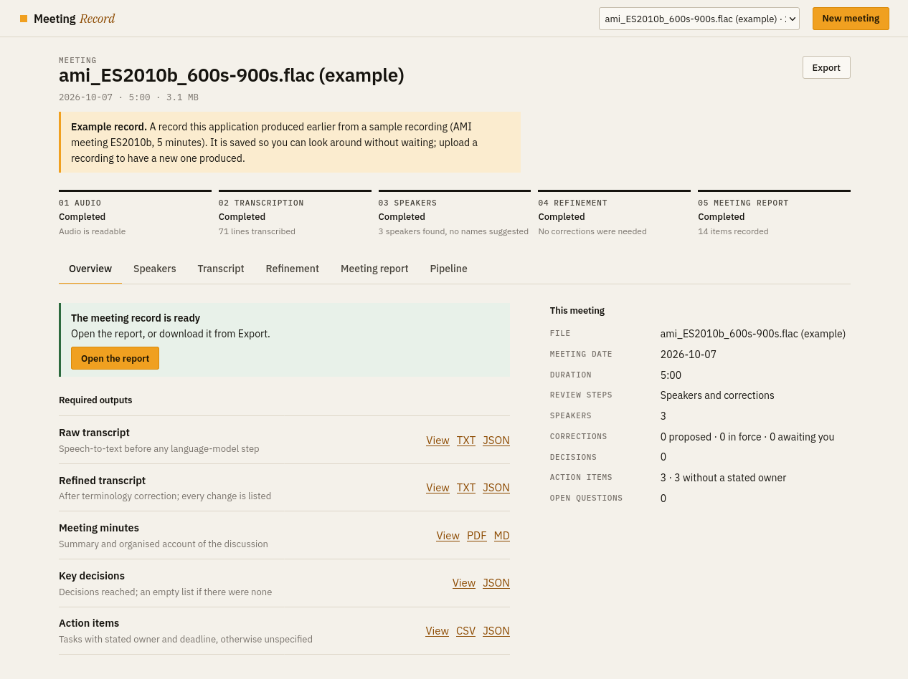
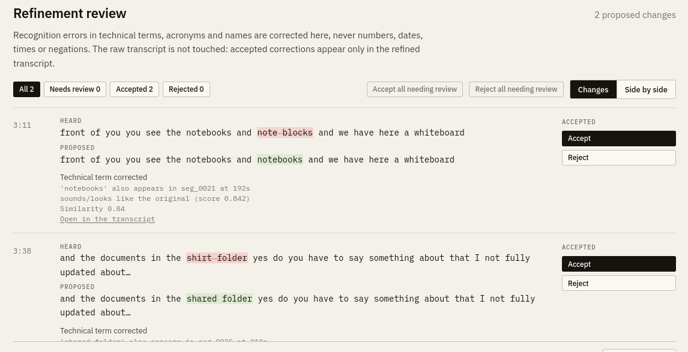
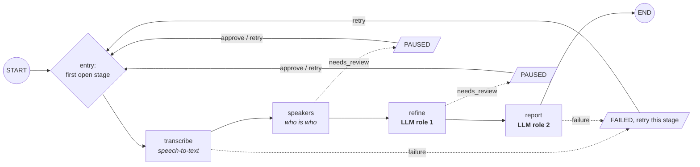
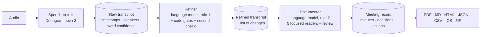

<div align="center">

# Meeting Intelligence Assistant

### From a recorded meeting to a verified, structured record

Transcript · terminology corrections · minutes · decisions · action items, every line traceable to what was said.


**Team Linear Regression** · Akansha Das · Atrijo Pal · Anuj Sharma
Inter IIT Bootcamp · ML Problem Statement, Phase 2

[Technical report (PDF)](docs/report/main.pdf) · [Quick start](#quick-start) · [How it works](#how-it-works) · [Models](#models-and-fallbacks)

</div>

---

## What it does

Upload an English meeting recording. In one run the application produces the five outputs the problem statement asks for, shows them side by side in an interactive workspace, and lets you download them.

| Output | Content | Where it appears | Export |
|---|---|---|---|
| **Raw transcript** | The speech-to-text result, before any language-model step | Transcript tab | TXT, JSON |
| **Refined transcript** | After domain-aware terminology correction; every change listed with its evidence | Refinement tab | TXT, JSON |
| **Meeting minutes** | Headline, summary, topics, open questions, key figures | Meeting report | PDF, Markdown, HTML |
| **Key decisions** | Decisions reached (an empty list if none) | Meeting report | JSON, report |
| **Action items** | Task, plus owner and deadline *only when stated*, otherwise **unspecified** | Meeting report | JSON, CSV, ICS |

The human-readable record (PDF, Markdown, HTML) and the machine-readable record (JSON, schema `meeting-record/1`) are generated from **one structure**, so they carry identical decisions and tasks. A test enforces it.

<table>
<tr>
<td width="50%"></td>
<td width="50%"></td>
</tr>
<tr>
<td align="center"><sub>Overview: stage status, next step, and the five outputs with view and download</sub></td>
<td align="center"><sub>Refinement review: every proposed change with its evidence</sub></td>
</tr>
</table>

## Why you can trust the output

Language models invent things. This system is built so that they cannot do it silently.

- **Every item has a quote.** A record is kept only if its quote appears *word for word* in the transcript; a quote may not skip a negation; a number in a record must be in its quote.
- **A proposal is not a decision.** A decision needs the group to settle it. A suggestion nobody agreed to stays a proposal, and an unstated assignment is never reported as a confirmed task.
- **Nothing guessed.** An owner is reported only when the speaker commits in the first person or is named in the quote; a deadline only when it is quoted. Otherwise the record says **unspecified**.
- **Corrections are edit-only and gated.** The refiner returns `find`/`replace` pairs, never rewritten text. A correction may not touch a number, date, time, duration or negation, may not add sentence punctuation, is size-limited, and is applied automatically only when the transcript itself supports it or an independent second check by a different model family confirms it. Everything else is a *suggestion* you accept or reject.
- **A second opinion on decisions and tasks.** A review call from a different model family can only *remove or weaken* a record, never add one.
- **If a step cannot run, the record says so.** A failed final check produces a visible banner, every decision tagged *not confirmed*, and a one-click retry. It is never hidden.
- **The raw transcript is never modified.** It is kept next to the refined one.

## How it works

The pipeline is a **LangGraph** state machine. The backend owns the state (a persisted `session.json` with an explicit status per stage); the interface only reads it. Two stages end in a **human checkpoint** where the graph pauses and resumes when you approve.





The two language-model roles are separate stages with their own prompts, models and outputs. The documenter reads the **refined** transcript, never the raw one. A stage that fails can be retried alone; finished stages are kept.

## Models and fallbacks

| Role | Model | Purpose |
|---|---|---|
| Speech-to-text | **Deepgram nova-3** | Whole file in one request: word timestamps, confidences, **voice-based speaker labels** |
| Speech-to-text (alternative) | Groq **whisper-large-v3** (10-minute chunks) | Used when no Deepgram key is set; text only, no speakers |
| Role 1: proposer | **gpt-oss-20b** (reasoning: medium) | Proposes small exact fixes to terms, acronyms, names |
| Role 1: second check | **qwen3.8-27b** (low) | A different model family confirms or rejects a fix that the recording does not itself support |
| Speaker names | **gpt-oss-20b** (low) | Suggests a name or role only with a quote that shows it |
| Role 2: readers | **qwen3.8-27b** ×4, **gpt-oss-120b** ×1 | Five focused readers: decisions and proposals; tasks, owners and deadlines (the 120b); questions and concerns; figures, topics and names; discussion points |
| Role 2: review | **gpt-oss-120b** (low) | Checks decisions and tasks, writes headline, summary and topic bullets |

Each call uses the smallest model and reasoning effort that does its job, and the review model is a different family from most readers, so it checks them independently.

**Fallbacks.** A call whose model is refused or unavailable is answered by a configurable backup (`FALLBACK_MODEL`, e.g. NVIDIA nemotron); an unreadable JSON answer is retried once with lower reasoning effort; a speech-to-text chunk falls back from `whisper-large-v3` to `whisper-large-v3-turbo`; a failed stage is retried alone. Any provider can be used by prefixing a model name (`nvidia:…`, `openrouter:…`).

### Prompts

All 13 prompts live in [`prompts/`](prompts) and are the only model instructions: `refine`, `verify_edits`, `names`, `speakers` (optional), five readers (`extract_decisions`, `extract_actions`, `extract_issues`, `extract_details`, `extract_discussion`), their two-reader and single-reader variants (`extract_core`, `extract_context`, `extract`) and `review`. Each treats the transcript as untrusted data and demands JSON only.

## Token efficiency

Compact transcript encoding (`u012 A: text`, merged short lines, short JSON keys) · numbers, dates, negations and rare words found **by code** and pre-flagged · refinement returns only edits · the review reads *records*, not the transcript · about 3,500 transcript tokens per call with a hard call cap · small models for narrow tasks · second check only for fixes the recording does not support · per-call and per-run token budgets (a run that would exceed them is refused before it starts) · a content-addressed cache and per-stage retry.

Measured on a 5-minute meeting (full run, all stages completed):

| Stage | Calls | Tokens |
|---|---:|---:|
| Speaker names | 1 | 1,757 |
| Refinement (+ check) | 1 | 3,531 |
| Five readers | 5 | 11,873 |
| Review and summary | 1 | 4,270 |
| **Total** | **8** | **21,431** (about 4.3k per minute of audio) |

## The workspace

Upload → Speakers → Transcript → Refinement → Meeting report → Export, plus a **Pipeline** tab that shows what each stage received and returned.

- **Upload:** WAV, MP3, M4A, FLAC, OGG, OPUS, WebM, AAC. Unsupported, empty, silent, corrupt or too-short files are rejected with a clear explanation.
- **Speakers:** suggested names with their evidence quote; accept, edit, or leave a speaker unnamed.
- **Transcript:** raw and refined views, search with highlighting, speaker filter, click any timestamp to play the real recording from that point, copy and download.
- **Refinement review:** original, proposed text, reason and evidence for every change; accept, reject, accept all, filters, side-by-side view.
- **Meeting report:** a numbered document; every item links back to its line in the transcript; uncertainty is listed with severity (info, review, warning, error).
- **Export:** only files that exist are offered, with professional names (`meeting_<date>_<kind>.<ext>`); a ZIP bundles them with a manifest.
- Clear status at all times, plain-language errors, a retry button for a failed stage, and a layout that works on a phone.

## Quick start

```bash
git clone https://github.com/atrijopal/boot.git && cd boot
cp .env.example .env        # paste your keys (below)
bash run.sh                 # installs everything on first run, then starts the app
# open http://localhost:8000
```

Works on Linux, macOS, and Windows through WSL or Git Bash. Needs `bash`, internet access, and `curl` or `pip`.

| Command | What it does |
|---|---|
| `bash run.sh` | install if needed and start the workspace on port 8000 |
| `bash run.sh --all FILE` | run the pipeline on one audio file from the terminal |
| `bash run.sh --check` | check that your API keys work |
| `bash run.sh --test` | run the test suite (no keys needed; recogniser and models are faked) |
| `PORT=8002 bash run.sh` | another port |

**Keys.** `GROQ_API_KEY` (required, <https://console.groq.com>) runs all the language models; `DEEPGRAM_API_KEY` (<https://console.deepgram.com>) gives speaker labels by voice. Optional: `NVIDIA_API_KEY` or `OPENROUTER_API_KEY` for the fallback model. Never commit `.env`.

<details>
<summary><b>Configuration</b> (<code>.env</code>)</summary>

| Variable | Default | Meaning |
|---|---|---|
| `ASR_PROVIDER` | `auto` | `auto` uses Deepgram (voices) when its key is set, otherwise Groq Whisper (text only) |
| `REFINE_MODEL` / `REFINE_EFFORT` | `openai/gpt-oss-20b` / `medium` | the refinement proposer |
| `VERIFY_EDITS_MODEL` | `qwen/qwen3.8-27b` | the independent second check of fixes |
| `EXTRACT_MODEL_DECISIONS` `_ACTIONS` `_ISSUES` `_DETAILS` `_DISCUSSION` | qwen ×4, gpt-oss-120b for actions | one model per reader |
| `REVIEW_MODEL` / `REVIEW_EFFORT` / `REVIEW_SCOPE` | `openai/gpt-oss-120b` / `low` / `decisions,actions` | final check and summary |
| `EXTRACTION_LENSES` | `5` | focused readers per window: 5, 2 or 1 |
| `PHASE3_MAX_CALLS` | `6` | hard cap on model calls in the report stage |
| `FALLBACK_MODEL` | empty | backup model used when a call is refused or unavailable |
| `MAX_CALL_TOKENS` / `MAX_RUN_TOKENS` | `7000` / `80000` | per-call and per-run token budgets |
| `RUN_TIMEOUT_SECONDS` | `600` | hard time limit for a stage |
| `CACHE_ENABLED` | `false` | reuse saved speech-to-text and model answers for identical inputs |

</details>

## API

```
POST /meetings                      upload (file, meeting_date, mode=review|auto) and start
GET  /meetings, /meetings/{id}      list; stages, issues, available exports
GET  /meetings/{id}/{transcript|speakers|refinement|report|pipeline}
POST /meetings/{id}/continue        {"stage": "speakers"|"refinement"}: approve and run on
POST /meetings/{id}/retry           {"stage": ...}: run a stage again
POST /meetings/{id}/edits/{edit}    {"decision": "accept|reject|reset"}
POST /meetings/{id}/speaker-names   name or un-name a speaker
GET  /meetings/{id}/audio           the recording, with range requests for seeking
GET  /meetings/{id}/exports, /export/{key}
```

<details>
<summary><b>Example of the machine-readable record</b></summary>

```json
{
  "schema_version": "meeting-record/1",
  "decisions": [{
    "id": "dec_001", "decision": "The group agreed to use a simple battery.", "status": "confirmed",
    "source": {"quote": "we'll use the simple battery", "speaker": "Speaker 2", "time": "7:41"}
  }],
  "action_items": [{
    "id": "act_001", "task": "Negotiate the production cost with the vendors.",
    "owner": "Speaker 1", "owner_stated": true, "deadline": "unspecified", "deadline_stated": false,
    "source": {"quote": "I will try to negotiate with the vendors", "speaker": "Speaker 1", "time": "3:12"}
  }],
  "minutes": {"headline": "…", "summary": ["…"], "topics": ["…"], "open_questions": [], "key_figures": []},
  "raw_transcript": ["…"], "refined_transcript": ["…"]
}
```

</details>

## Evaluation

Ground truth comes from the public human transcripts and annotations of the [AMI Meeting Corpus](https://groups.inf.ed.ac.uk/ami/corpus/) (CC BY 4.0). `scripts/make_reference.py` builds a reference for any clip and `scripts/evaluate.py` scores a run.

| Measurement (single runs) | Result |
|---|---|
| Word error rate, Deepgram nova-3, quiet meeting (12 min) | 19.8% |
| Word error rate, Deepgram nova-3, loud office meeting (12 min) | 25.4% |
| Word error rate, Deepgram nova-3, 8-minute design meeting | 24.5% |
| Words attributed to the correct speaker (4 real speakers found) | 95.7% / 86.5% / 89.2% |

Most word errors are words lost where people talk over each other. **181 automated tests** run offline with a faked recogniser and model: the gates, graph routing, session recovery, every export, error messages, and a scan proving that no model name, token count or prompt text reaches a user-visible page or file.

## Samples

[`samples/`](samples) has recordings of 5 to 15 minutes from the AMI corpus (including the 7- and 8-minute demo clips), human reference transcripts, inputs that must fail cleanly (`bad/`), and a saved example meeting with all its generated outputs in [`samples/example_outputs/`](samples/example_outputs): raw and refined transcript, minutes, decisions and action items. A saved example is labelled **Example** in the interface and is never returned for a new upload: every new recording is processed by the pipeline.

## Project structure

```
app/api.py, app/meetings.py   FastAPI application and the meeting workspace API
app/core/                     graph (LangGraph), session (persisted state), pipeline (stage code),
                              steps / gates / review / echoes (model calls and every code check),
                              views, issues, errors, wording, record, exports, pdf, examples
app/asr/ app/audio/ app/llm/  speech-to-text providers, audio preparation, model client with provider routing
app/refinement/               the correction gate (verbatim, invariants, evidence, similarity)
prompts/                      all 13 model instructions
web/                          index.html, static/app.css, static/js/ (one file per view), IBM Plex fonts
scripts/                      run_all, check_keys, make_reference, evaluate, fetch_sample
tests/                        offline test suite
docs/report/                  technical report (LaTeX source and PDF)
```

## Limits

English only. Language models can be wrong; the checks reduce this but do not prove correctness. Speaker separation needs the Deepgram provider (guessing speakers from text alone was measured at chance level and is off). Free-tier model quotas can slow a run or stop the final check; the record then says so and offers a retry. Meetings beyond about 15 minutes are covered by tests with a fake model, not by live runs.

## Acknowledgements

Sample meetings are excerpts from the AMI Meeting Corpus (Carletta et al., CC BY 4.0). Interface typeface: IBM Plex (SIL Open Font License).

<div align="center"><sub>Built by <b>Team Linear Regression</b></sub></div>
